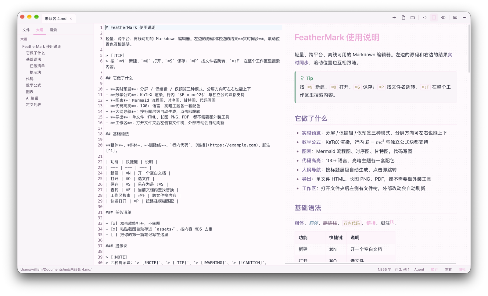
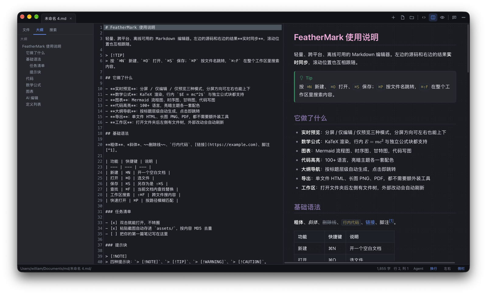
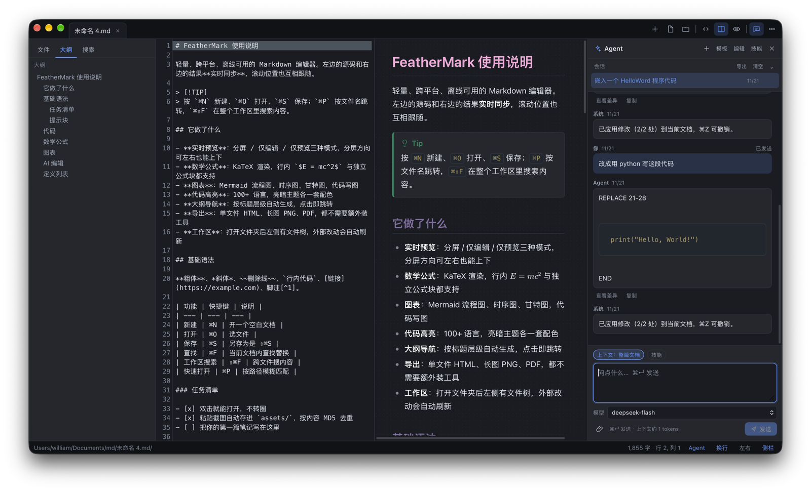

# FeatherMark

[中文](README.md)

A lightweight, cross-platform, offline Markdown editor. Double-click to open, write on the left and preview on the right, with math and diagrams built in — plus an AI assistant that can actually edit your document.







## Why FeatherMark

| Common pain | How FeatherMark solves it |
| --- | --- |
| Plugins needed just to render math and diagrams | KaTeX, Mermaid and syntax highlighting built in — zero plugins |
| Electron apps eating hundreds of MB | Tauri reuses the system WebView; the release build is about 10 MB |
| Source and preview drifting apart, preview not editable | Synchronized split scrolling; edit rendered text directly in preview mode with live Markdown sync |
| AI rewriting the whole document — slow and unpredictable | The agent returns patches (`REPLACE` / `DELETE` / `INSERT`) applied locally by line number; review the diff before writing |
| Export requires yet another tool | Single-file HTML, long-image PNG and PDF, all generated offline |

## Features

**Editing & preview**
- Three views: source / split / preview. Preview mode uses native CodeMirror 6 decorations for true WYSIWYG — headings, emphasis, lists, quotes, task boxes and math render in place while text stays editable, synced back to Markdown with no flicker or cursor jumps
- GFM tables, task lists (click to check, written back to source), strikethrough, footnotes, definition lists and `> [!NOTE]` callouts
- KaTeX inline / block math, Mermaid diagrams, syntax highlighting for 100+ languages
- List continuation and nested indentation, bracket pairing, find & replace, Chinese context menu; pasted screenshots are saved to a local `assets/` folder and de-duplicated by MD5

**AI agent (`⌘L`)**
- Collapsible, resizable right sidebar; sessions are stored per workspace, with skills (`SKILL.md`), prompt templates, attachments and streaming replies
- Document context can be the whole file, the selection, or off; replies and code blocks have copy buttons
- Edits flow through patch → before/after diff → editable diff lines → confirmed write-back, with undo. Local validation rejects malformed output, retries once with feedback, and never replaces a document with a truncated reply
- Seven reusable editing templates (polish / condense / expand / reformat / proofread / translate / custom), accessible via `⌘J`

**Themes & appearance**
- Six built-in themes plus custom themes managed as cards: AI-generated palettes, palette rename/export, and per-theme background canvas, wallpaper and typography settings
- Chinese / English UI switch; configurable fonts, line height, letter spacing and cursor width

**Files & export**
- Multiple tabs, workspace file tree, auto-reload on external changes, `⌘P` quick open, `⌘⇧F` workspace search
- Single-file HTML (inlined images and fonts), 2× long-image PNG, A4-paginated PDF

## Getting started

Requirements: Node ≥ 18, Rust stable; Xcode Command Line Tools on macOS, WebView2 + MSVC on Windows.

```bash
npm install      # frontend dependencies
npm run dev      # development mode
npm run build    # release build (.app / .msi / .deb, depending on platform)
```

For AI features, open Settings → AI and enter an OpenAI-compatible base URL, model ID and API key (the key is stored locally with 600 permissions). There is no built-in provider preset table — follow your provider's official docs.

## Common shortcuts

| | | | |
| --- | --- | --- | --- |
| New `⌘N` | Open `⌘O` | Save `⌘S` | Settings `⌘,` |
| Quick open `⌘P` | Find `⌘F` | Workspace search `⇧⌘F` | Export HTML `⇧⌘E` |
| Agent `⌘L` | AI edit `⌘J` | Bold `⌘B` | Italic `⌘I` |

## Project layout

```
src/           Frontend: index.html, styles.css, unified-renderer.js, app/ (editor, agent, export, settings, ...)
src-tauri/     Rust backend: file commands, AI proxy, window and packaging config
assets/        Bundled resources such as welcome.md
docs/          README screenshots
scripts/       Build helpers (Windows cross-compilation, etc.)
```

Stack: Tauri v2 + Rust · CodeMirror 6 · unified/remark · KaTeX · Mermaid. The preview renderer and file command layer were ported from [TizuMark](https://github.com/tizuio/TizuMark-Markdown-Editor) (GPL-3.0); this project is also released under GPL-3.0 — see `NOTICE.md`.

## Known limits

- In preview mode, structured content such as tables, math, code blocks and Mermaid diagrams is read-only to avoid accidental corruption; text blocks are directly editable
- Large documents use render debouncing and caching but no virtual scrolling — split files beyond ~100k lines
- The UI is bilingual; system prompts and editing templates stay in Chinese for stable model behavior
- Tested on macOS; a Windows portable build is produced but not yet verified on real hardware, and the Linux code path is written but untested

## License

GPL-3.0. The renderer and some Rust commands come from TizuMark and are used and distributed under its GPL-3.0 terms — see `NOTICE.md`.
