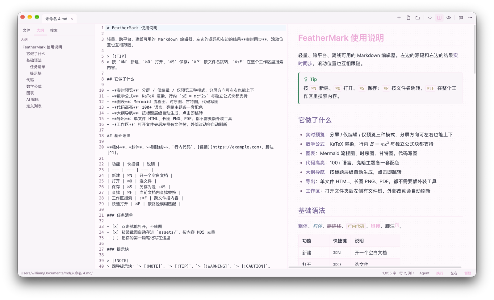

# FeatherMark 轻羽

[English](README.en.md)

轻量、跨平台、离线可用的 Markdown 编辑器。双击即开，左边写右边看，公式图表都内置，还带一个能改文档的 AI 助手。




## 为什么选它

| 常见痛点 | FeatherMark 的做法 |
| --- | --- |
| 装一堆插件才能看公式和图表 | KaTeX、Mermaid、代码高亮全部内置，零插件 |
| Electron 应用起步几百 MB 内存 | Tauri 复用系统 WebView，正式包约 10 MB |
| 预览和源码对不上、预览里改不了 | 分屏双向滚动同步；预览模式直接在渲染结果上编辑，文字所见即所得，源码随时可切 |
| AI 改文档要全文重写、又贵又不可控 | Agent 只回补丁指令（`REPLACE` / `DELETE` / `INSERT`），本地按行号打补丁，先看前后对比再决定是否写入 |
| 写完了还要另找工具导出 | 单文件 HTML / 长图 PNG / PDF，全部离线生成 |

## 核心功能

**编辑与预览**
- 三种视图：源码 / 分屏 / 仅预览；预览模式用 CodeMirror 6 原生 decoration 实现所见即所得——标题、粗斜体、列表、引用、任务框、公式都直接渲染，文字始终可编辑，改完实时同步回 Markdown，不闪屏不跳版
- GFM 表格、任务清单（点击勾选回写源码）、删除线、脚注、定义列表、提示块 `> [!NOTE]`
- KaTeX 行内 / 独立公式、Mermaid 图表、100+ 语言代码高亮
- 列表自动续写与多级缩进、括号配对、查找替换、中文右键菜单；截图粘贴自动存到同目录 `assets/` 并按 MD5 去重

**AI 助手（Agent 面板 `⌘L`）**
- 右侧可折叠、可拖宽；会话按工作区保存在本机，支持技能（`SKILL.md`）、问题模板、附件、流式回复
- 文档上下文可选整篇 / 选区 / 关闭；回复可复制，代码块有独立复制按钮
- 改文档时输出补丁 → 前后对比 → 差异行可直接编辑 → 确认写回，可撤销；模型不守协议时本地校验拦截、回喂重试一轮、异常时拒绝整篇替换
- 内置 7 个编辑模板（润色 / 精简 / 扩写 / 排版整理 / 纠错 / 翻译 / 自定义），入口 `⌘J`

**主题与外观**
- 6 套内置主题 + 自定义主题卡片式管理：AI 生成配色、配色的重命名与导出、每个主题独立绑定背景画布 / 背景图 / 排版参数
- 中英文界面一键切换；字体、行高、字距、光标宽度可调

**文件与导出**
- 多标签、工作区文件树、外部改动自动重载、`⌘P` 快速打开、`⌘⇧F` 全工作区搜索
- 单文件 HTML（图片和字体内联）、2 倍长图 PNG、A4 分页 PDF

## 快速开始

前置：Node ≥ 18、Rust stable；macOS 需 Xcode Command Line Tools，Windows 需 WebView2 + MSVC。

```bash
npm install      # 前端依赖
npm run dev      # 开发模式
npm run build    # 出正式包（.app / .msi / .deb，取决于平台）
```

AI 功能需在「设置 → AI」填 OpenAI 兼容的接口地址、模型和 API Key（密钥只存本机，权限 600）。不内置服务商预设表，按所用服务的官方文档填写即可。

## 常用快捷键

| | | | |
| --- | --- | --- | --- |
| 新建 `⌘N` | 打开 `⌘O` | 保存 `⌘S` | 设置 `⌘,` |
| 快速打开 `⌘P` | 查找 `⌘F` | 工作区搜索 `⇧⌘F` | 导出 HTML `⇧⌘E` |
| Agent 对话 `⌘L` | AI 编辑 `⌘J` | 加粗 `⌘B` | 斜体 `⌘I` |

## 项目结构

```
src/           前端：index.html、styles.css、unified-renderer.js、app/（编辑器 / Agent / 导出 / 设置等）
src-tauri/     Rust 后端：文件命令、AI 转发、窗口与打包配置
assets/        welcome.md 等内置资源
docs/          README 截图
scripts/       构建辅助脚本（Windows 交叉编译等）
```

技术栈：Tauri v2 + Rust · CodeMirror 6 · unified/remark · KaTeX · Mermaid。预览渲染器与文件命令层移植自 [TizuMark](https://github.com/tizuio/TizuMark-Markdown-Editor)（GPL-3.0），本项目同样以 GPL-3.0 发布，详见 `NOTICE.md`。

## 已知边界

- 预览模式下表格、公式、代码块、Mermaid 等结构化内容为只读展示（避免误改结构）；文本块可直接编辑
- 大文档有渲染防抖与缓存，但未做虚拟滚动，十万行级建议拆文件
- 界面支持中英双语；发给 AI 的 system prompt 与编辑模板正文固定用中文以保证模型行为稳定
- 目前在 macOS 上实测；Windows 便携版已产出但尚未真机验证，Linux 代码路径已写好未实测

## 许可

GPL-3.0。渲染器与部分 Rust 命令来自 TizuMark，按其条款使用与分发，见 `NOTICE.md`。
