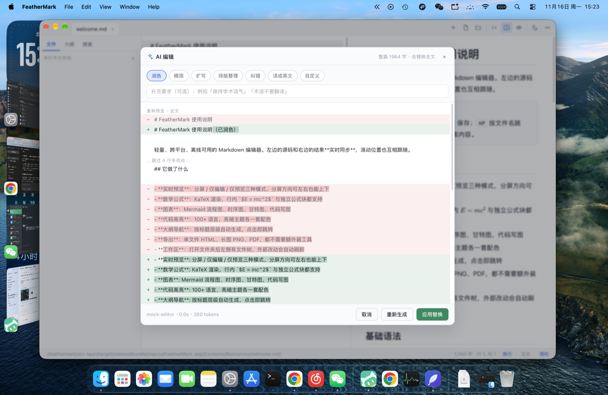

# FeatherMark 轻羽

轻量、跨平台、离线可用的 Markdown 编辑器。双击即开，左边写、右边看，公式和图表都内置。

> 实现方式参考开源项目 [TizuMark](https://github.com/tizuio/TizuMark-Markdown-Editor)（GPL-3.0）：
> 同样的 **Tauri v2 + Rust** 外壳、原生 **CodeMirror 5** 编辑器、**unified/remark** 渲染管线。
> 其中预览渲染器（`src/unified-renderer.js`、`src/md2/`）与文件命令层直接移植自该项目，
> 因此本项目同样以 **GPL-3.0** 发布，详见 `NOTICE.md`。




## 为什么是它

| 常见痛点 | 这个项目的做法 |
| --- | --- |
| 装一堆插件才能看公式和图表 | KaTeX、Mermaid、代码高亮全部内置，零插件 |
| Electron 应用起步几百 MB 内存 | Tauri 复用系统 WebView，正式包约 10 MB |
| 预览和源码各看一屏，来回对不上 | 分屏 + 双向滚动同步；也能切成纯编辑 / 纯预览 |
| 长文档里找不到章节 | 按标题自动生成大纲，点一下跳过去 |
| 写完了还要另找工具导出 | 单文件 HTML / 长图 PNG / PDF，全部离线生成 |

## 功能

**编辑**
- CodeMirror 5（Markdown 语法高亮、列表自动续写、括号自动配对、Tab 缩进）
- `⌘B` 加粗、`⌘I` 斜体、`⌘K` 链接、`⌘/` 注释切换
- 粘贴或拖入截图自动存进同目录 `assets/`，文件名取内容 MD5，天然去重
- 文档内查找替换（`⌘F`），命中项全部高亮

**预览**
- GFM：表格、任务清单（可直接点勾选，回写源码）、删除线
- KaTeX 行内 / 独立公式（`$…$`、`$$…$$`、`\(…\)`、`\[…\]`）
- Mermaid 流程图 / 时序图 / 甘特图，跟随明暗主题
- 提示块 `> [!NOTE]` `> [!TIP]` `> [!WARNING]` `> [!CAUTION]`
- 脚注、定义列表、`[TOC]`、emoji 短码、HTML 净化（rehype-sanitize + 字符串级兜底）
- 图片点击放大：滚轮以光标为锚点缩放、拖动平移、双击复位

**Agent 对话侧边栏（⌘L）**
- 右侧可折叠、可拖宽的 Agent 面板；会话按工作区保存在本机，重启后继续聊
- 支持问题模板一键填充、内置 Skills 查看/启用/调用
- 可添加文件或图片：选择或拖入，显示预览、删除按钮和「就绪 / 发送中 / 已发送 / 失败」状态；关闭文档上下文时附件仍会发送，二进制文件不会被读成乱码
- 自动携带当前文档与选中内容作为上下文（可一键关闭）；回复可复制；写回文档必须先看差异，用户选择应用内容与范围、确认完整后点「同意修改」才写入
- 加载、空状态、错误与重试都有明确界面；AI 未配置时直接指向「设置 → AI」

**Agent 编辑模板（⌘J / Agent 面板「编辑」/ 更多菜单）**
- 原来的 AI 编辑已并入 Agent 模块；入口都走同一套模板流程，没有独立弹窗逻辑
- 7 个可复用编辑模板：润色、精简、扩写、排版整理、纠错、翻译、自定义
- 每个模板可配置自己的参数（如翻译方向、补充要求），执行范围可选当前选区或整篇
- 仍保留原有习惯：模型只回补丁 → 逐块 diff → 勾选接受 → 应用替换，⌘Z 可撤销
- 模板定义在 `src/app/edit-templates.js`，新增编辑能力只需加一条模板，不改 UI 与执行逻辑


### 模型配置

本项目**不内置服务商预设表**。模型、端点和参数规则迭代太快，与其维护一张很快过时的表格，不如留空由你按所用服务的官方文档填写：

- **接口地址**：OpenAI 兼容的 Base URL，例如 `https://<服务商>/v1`
- **模型**：该服务当前可用的模型 ID（以官方文档为准）
- **API Key**：只写进本机配置文件，权限 600
- **额外请求参数**：需要 `thinking`、`reasoning_effort` 等字段时，填一个 JSON 对象；它会合并进请求体，但不能覆盖 `model` / `messages` / `max_tokens` / `stream`
- **不发送 temperature**：有些推理模型会拒绝这个字段，勾上后整个字段不发给服务端
- **推理模型的 token**：DeepSeek-Flash、GLM-5.3、Kimi K3 这类模型会先生成 `reasoning_content`，
  它也会计入 output token 与耗时。以 DeepSeek-Flash 为例，不关思考时一次编辑用了 4852 output tokens / 36s；
  在「额外请求参数」填 `{"thinking":{"type":"disabled"}}` 后，同一次测试只返回 1 output token。

DeepSeek、OpenAI、Kimi、智谱、百炼、Gemini、Groq、硅基流动、Ollama、自建 vLLM 等只要是 OpenAI 兼容接口都可以接，具体型号请查各家官方文档。

**它是个补丁式编辑 agent，不是「让模型重写一遍」**
模型只回编辑指令（`REPLACE 12-14` / `DELETE 20-22` / `INSERT 30`），本地按行号打补丁：

| | 整篇重写 | 补丁式（本项目） |
| --- | --- | --- |
| 122 行文档改 2 处 | 输出 ~1500 tokens | 输出 **54 tokens** |
| 延迟 | 与文档长度成正比 | 主要花在输入侧，输出瞬间完成 |

撑住可靠性的是三件事，都在本地做：
1. **校验**：行号越界、代码围栏不成对、`finish_reason=length`（被截断）都会拦下来；
   选「排版整理」时还会比对「去掉空白与格式符号后的字符序列」，真的能让它一个字都没改。
2. **自愈**：校验没过就把具体问题回喂模型重试**一轮**——多轮会拖慢，不值。
3. **回退护栏**：模型不按协议、直接给整段改写时自动按整篇处理；但如果它只回了 `END` 这种片段、
   或者输出短到 25% 以下（疑似截断），一律拒绝，绝不把文档替换成半截内容。

**工作区**
- 打开文件夹 → 左侧文件树，右键新建 / 重命名 / 删除 / 在文件管理器中显示
- 外部程序改动文件会监听并提示（干净的标签自动重载，有未保存改动时只提醒不覆盖）
- `⌘P` 按路径模糊查找文件，`⌘⇧F` 跨文件搜内容
- 多标签页，可拖拽排序、中键关闭；关闭后重开恢复上次的标签和工作区
- 拖文件或文件夹到窗口即可打开

**外观**
- 浅色 / 深色 / 跟随系统；四套配色（墨蓝、松绿、琥珀、紫罗兰）
- 编辑器、预览、代码块三处字体分别可设，字体列表来自系统全集

**导出**
- 单文件 HTML：内联样式、图片转 base64、KaTeX 字体内嵌，发给别人直接能看
- 长图 PNG：2 倍清晰度
- PDF：按 A4 自动分页

## 快捷键

| 操作 | 快捷键 | 操作 | 快捷键 |
| --- | --- | --- | --- |
| 新建 | `⌘N` | 保存 | `⌘S` |
| 打开 | `⌘O` | 另存为 | `⇧⌘S` |
| 关闭标签 | `⌘W` | 设置 | `⌘,` |
| 快速打开 | `⌘P` | 查找替换 | `⌘F` |
| 工作区搜索 | `⇧⌘F` | 切换分屏方向 | `⌘\` |
| 放大 / 缩小字号 | `⌘=` / `⌘-` | 导出 HTML | `⇧⌘E` |
| Agent 对话 | `⌘L` | AI 编辑 | `⌘J` |
| 生成 / 应用（AI 面板内） | `⌘↩` | 发送（Agent 对话） | `⌘↩` |

## 开发

前置：Node ≥ 18、Rust stable；macOS 需要 Xcode Command Line Tools，Windows 需要 WebView2 + MSVC。

```bash
npm install          # 安装前端依赖
npm run dev          # 开发模式（tauri 会先跑 build.mjs 生成 bundle）
npm run build        # 出正式包（.app / .msi / .deb，取决于当前平台）
npm run assets       # 只重新生成 src/lib 下的 bundle 与静态资源
```

目录结构：

```
src/
├── index.html            入口（经典 <script> 加载，不用 ESM 模块图）
├── styles.css            全部样式（设计变量 → 布局 → 预览排版 → 浮层）
├── unified-renderer.js   Markdown → HTML 渲染器（移植自 TizuMark）
├── md2/                  自定义表格方言（渲染器依赖）
├── app/                  应用层
│   ├── main.js           编排：标签、文件、快捷键、会话
│   ├── ipc.js            唯一的后端边界（所有 invoke 都在这里）
│   ├── editor.js         CodeMirror 封装 + 格式化动作 + 查找
│   ├── preview.js        渲染 + KaTeX/Mermaid/hljs 后处理 + 滚动换算
│   ├── tree.js           工作区文件树
│   ├── tabs.js / search.js / quickopen.js / settings.js
│   ├── ai.js             AI 编辑面板：动作、交互、行级 diff
│   ├── agent.js          编辑 agent：补丁协议、本地校验、自愈与回退
│   ├── exporters.js      HTML / PNG / PDF 导出
│   ├── store.js          偏好与会话持久化
│   └── ui.js             toast / 菜单 / 分隔条 / 图片查看器
└── lib/                  构建产物（CodeMirror、KaTeX、两个 esbuild bundle，已 gitignore）
src-tauri/
├── src/lib.rs            文件读写、目录树、监听、图片入库、字体枚举、全文搜索
├── src/ai.rs             AI 配置（本机 0600）+ OpenAI 兼容接口转发（密钥不出 Rust）
├── tauri.conf.json       窗口与打包配置
└── tauri.macos.conf.json macOS 专属：系统红绿灯 + Overlay 标题栏
```

## 已知边界

- 目前**没有**即时渲染（WYSIWYG）编辑模式，是「源码 + 实时预览」的分屏形态
- 大文档做了渲染防抖与滚动位置换算，但没有做虚拟滚动；十万行级文档建议拆文件
- 界面仅中文
- AI 调用是非流式的（等整段返回）。因为只回补丁，输出很短，实际等待主要在输入侧；
  整篇超长文档（上万字）输入本身就很贵，建议选中一段处理
- 只在 macOS（Apple Silicon）上实测过；Windows / Linux 的三平台代码路径都已写好（自绘标题栏、`explorer /select`、`xdg-open`），但未实机验证

## 许可

GPL-3.0。渲染器与部分 Rust 命令来自 TizuMark，按其 GPL-3.0 条款使用与分发，见 `NOTICE.md`。
