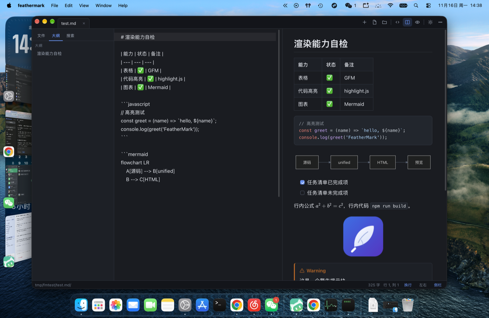

# FeatherMark 轻羽

轻量、跨平台、离线可用的 Markdown 编辑器。双击即开，左边写、右边看，公式和图表都内置。

> 实现方式参考开源项目 [TizuMark](https://github.com/tizuio/TizuMark-Markdown-Editor)（GPL-3.0）：
> 同样的 **Tauri v2 + Rust** 外壳、原生 **CodeMirror 5** 编辑器、**unified/remark** 渲染管线。
> 其中预览渲染器（`src/unified-renderer.js`、`src/md2/`）与文件命令层直接移植自该项目，
> 因此本项目同样以 **GPL-3.0** 发布，详见 `NOTICE.md`。




## 为什么是它

| 常见痛点 | 这个项目的做法 |
| --- | --- |
| 装一堆插件才能看公式和图表 | KaTeX、Mermaid、代码高亮全部内置，零插件 |
| Electron 应用起步几百 MB 内存 | Tauri 复用系统 WebView，正式包约 10 MB |
| 预览和源码各看一屏，来回对不上 | 分屏 + 双向滚动同步；也能切成纯编辑 / 纯预览 |
| 长文档里找不到章节 | 按标题自动生成大纲，点一下跳过去 |
| 写完了还要另找工具导出 | 单文件 HTML / 长图 PNG / PDF，全部离线生成 |

## 功能

**编辑**
- CodeMirror 5（Markdown 语法高亮、列表自动续写、括号自动配对、Tab 缩进）
- `⌘B` 加粗、`⌘I` 斜体、`⌘K` 链接、`⌘/` 注释切换
- 粘贴或拖入截图自动存进同目录 `assets/`，文件名取内容 MD5，天然去重
- 文档内查找替换（`⌘F`），命中项全部高亮

**预览**
- GFM：表格、任务清单（可直接点勾选，回写源码）、删除线
- KaTeX 行内 / 独立公式（`$…$`、`$$…$$`、`\(…\)`、`\[…\]`）
- Mermaid 流程图 / 时序图 / 甘特图，跟随明暗主题
- 提示块 `> [!NOTE]` `> [!TIP]` `> [!WARNING]` `> [!CAUTION]`
- 脚注、定义列表、`[TOC]`、emoji 短码、HTML 净化（rehype-sanitize + 字符串级兜底）
- 图片点击放大：滚轮以光标为锚点缩放、拖动平移、双击复位

**工作区**
- 打开文件夹 → 左侧文件树，右键新建 / 重命名 / 删除 / 在文件管理器中显示
- 外部程序改动文件会监听并提示（干净的标签自动重载，有未保存改动时只提醒不覆盖）
- `⌘P` 按路径模糊查找文件，`⌘⇧F` 跨文件搜内容
- 多标签页，可拖拽排序、中键关闭；关闭后重开恢复上次的标签和工作区
- 拖文件或文件夹到窗口即可打开

**外观**
- 浅色 / 深色 / 跟随系统；四套配色（墨蓝、松绿、琥珀、紫罗兰）
- 编辑器、预览、代码块三处字体分别可设，字体列表来自系统全集

**导出**
- 单文件 HTML：内联样式、图片转 base64、KaTeX 字体内嵌，发给别人直接能看
- 长图 PNG：2 倍清晰度
- PDF：按 A4 自动分页

## 快捷键

| 操作 | 快捷键 | 操作 | 快捷键 |
| --- | --- | --- | --- |
| 新建 | `⌘N` | 保存 | `⌘S` |
| 打开 | `⌘O` | 另存为 | `⇧⌘S` |
| 关闭标签 | `⌘W` | 设置 | `⌘,` |
| 快速打开 | `⌘P` | 查找替换 | `⌘F` |
| 工作区搜索 | `⇧⌘F` | 切换分屏方向 | `⌘\` |
| 放大 / 缩小字号 | `⌘=` / `⌘-` | 导出 HTML | `⇧⌘E` |

## 开发

前置：Node ≥ 18、Rust stable；macOS 需要 Xcode Command Line Tools，Windows 需要 WebView2 + MSVC。

```bash
npm install          # 安装前端依赖
npm run dev          # 开发模式（tauri 会先跑 build.mjs 生成 bundle）
npm run build        # 出正式包（.app / .msi / .deb，取决于当前平台）
npm run assets       # 只重新生成 src/lib 下的 bundle 与静态资源
```

目录结构：

```
src/
├── index.html            入口（经典 <script> 加载，不用 ESM 模块图）
├── styles.css            全部样式（设计变量 → 布局 → 预览排版 → 浮层）
├── unified-renderer.js   Markdown → HTML 渲染器（移植自 TizuMark）
├── md2/                  自定义表格方言（渲染器依赖）
├── app/                  应用层
│   ├── main.js           编排：标签、文件、快捷键、会话
│   ├── ipc.js            唯一的后端边界（所有 invoke 都在这里）
│   ├── editor.js         CodeMirror 封装 + 格式化动作 + 查找
│   ├── preview.js        渲染 + KaTeX/Mermaid/hljs 后处理 + 滚动换算
│   ├── tree.js           工作区文件树
│   ├── tabs.js / search.js / quickopen.js / settings.js
│   ├── exporters.js      HTML / PNG / PDF 导出
│   ├── store.js          偏好与会话持久化
│   └── ui.js             toast / 菜单 / 分隔条 / 图片查看器
└── lib/                  构建产物（CodeMirror、KaTeX、两个 esbuild bundle，已 gitignore）
src-tauri/
├── src/lib.rs            文件读写、目录树、监听、图片入库、字体枚举、全文搜索
├── tauri.conf.json       窗口与打包配置
└── tauri.macos.conf.json macOS 专属：系统红绿灯 + Overlay 标题栏
```

## 已知边界

- 目前**没有**即时渲染（WYSIWYG）编辑模式，是「源码 + 实时预览」的分屏形态
- 大文档做了渲染防抖与滚动位置换算，但没有做虚拟滚动；十万行级文档建议拆文件
- 界面仅中文
- 只在 macOS（Apple Silicon）上实测过；Windows / Linux 的三平台代码路径都已写好（自绘标题栏、`explorer /select`、`xdg-open`），但未实机验证

## 许可

GPL-3.0。渲染器与部分 Rust 命令来自 TizuMark，按其 GPL-3.0 条款使用与分发，见 `NOTICE.md`。
