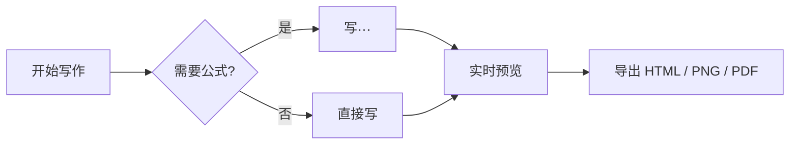
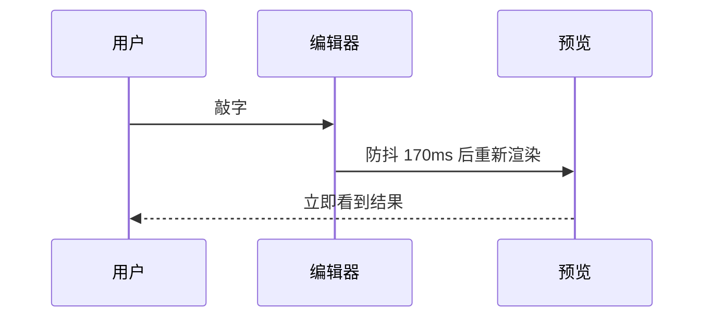

# FeatherMark 使用说明

轻量、跨平台、离线可用的 Markdown 编辑器。左边的源码和右边的结果**实时同步**，滚动位置也互相跟随。

> [!TIP]
> 按 `⌘N` 新建、`⌘O` 打开、`⌘S` 保存；`⌘P` 按文件名跳转，`⌘⇧F` 在整个工作区里搜索内容。

## 它做了什么

- **实时预览**：分屏 / 仅编辑 / 仅预览三种模式，分屏方向可左右也能上下
- **数学公式**：KaTeX 渲染，行内 `$E = mc^2$` 与独立公式块都支持
- **图表**：Mermaid 流程图、时序图、甘特图，代码写图
- **代码高亮**：100+ 语言，亮暗主题各一套配色
- **大纲导航**：按标题层级自动生成，点击即跳转
- **导出**：单文件 HTML、长图 PNG、PDF，都不需要额外装工具
- **工作区**：打开文件夹后左侧有文件树，外部改动会自动刷新

## 基础语法

**粗体**、*斜体*、~~删除线~~、`行内代码`、[链接](https://example.com)、脚注[^1]。

| 功能 | 快捷键 | 说明 |
| --- | --- | --- |
| 新建 | ⌘N | 开一个空白文档 |
| 打开 | ⌘O | 选文件 |
| 保存 | ⌘S | 另存为是 ⇧⌘S |
| 查找 | ⌘F | 当前文档内查找替换 |
| 工作区搜索 | ⇧⌘F | 跨文件搜内容 |
| 快速打开 | ⌘P | 按路径模糊匹配 |

### 任务清单

- [x] 双击就能打开，不转圈
- [x] 粘贴截图自动存进 `assets/`，按内容 MD5 去重
- [ ] 把你的第一篇笔记写在这里

### 提示块

> [!NOTE]
> 四种提示块：`> [!NOTE]`、`> [!TIP]`、`> [!WARNING]`、`> [!CAUTION]`。

> [!WARNING]
> 提示块里的内容依然支持 **Markdown**、列表和公式。

## 代码

```python
def fib(n: int) -> int:
    a, b = 0, 1
    for _ in range(n):
        a, b = b, a + b
    return a

print([fib(i) for i in range(10)])
```

```javascript
const render = async (md) => {
  const html = UnifiedRenderer.renderMarkdown(md, { softBreaks: false });
  preview.innerHTML = html;
  await mermaid.run({ nodes: preview.querySelectorAll('.mermaid') });
};
```

## 数学公式

行内公式：质能方程 $E = mc^2$，欧拉恒等式 $e^{i\pi} + 1 = 0$。

独立公式：

$$
\int_{-\infty}^{\infty} e^{-x^2}\,dx = \sqrt{\pi}
$$

$$
\mathbf{A} = \begin{pmatrix} a_{11} & a_{12} \\ a_{21} & a_{22} \end{pmatrix}
$$

## 图表





## AI 编辑

选中一段文字（或什么都不选，对整篇下手），按 `⌘J`：挑一个动作 —— 润色 / 精简 / 扩写 / 排版整理 / 纠错 / 翻译（中英互译），或写一句自己的要求。

生成后先看**差异**：红色是原文、绿色是建议，改动处还会精确标到字符。改动被分成若干块，每块前面都能单独勾选——只想要其中三处就取消勾选其余的，点「只应用已选」；全都要就点「全部替换」。写回文档后按 `⌘Z` 依然可以撤销。

模型接口在 `设置 → AI` 里配，支持 DeepSeek / OpenAI / Moonshot / 智谱 / 本地 Ollama 等 OpenAI 兼容服务。API Key 只存在本机配置文件里（权限 600），不会进浏览器存储，也不会离开你的电脑。

## 定义列表

Markdown
: 一种用纯文本表达结构化文档的标记语法。

FeatherMark
: 用 Tauri + Rust + CodeMirror 实现的桌面编辑器，安装包只有几 MB。

---

写点东西试试。所有内容都保存在你自己的磁盘上，不联网、不注册。

[^1]: 脚注也支持，点击右上角的编号可以跳回原文。
